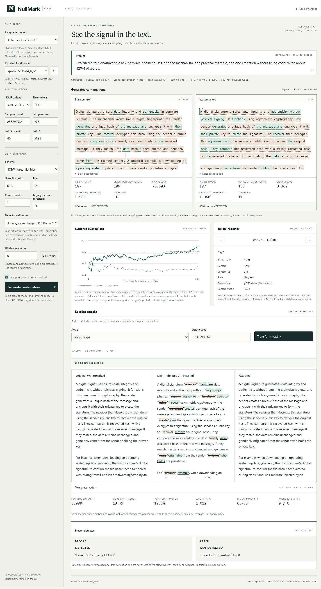

# NullMark

**Measuring text-watermark disruption against text preservation.**

Current release: **v0.2.0 — Baseline Attacks**.

NullMark is a controlled robustness benchmark for open KGW and SynthID text
watermarks, locally controlled models and private keys. Four simple keyless,
detector-blind transformations establish baselines for later sparse research:

|Attack|What changes|
|---|---|
|Random Edit|Seeded random single-word substitutions from conservative alternatives|
|Local Replacement|Qwen proposes minimal contextual lexical replacements|
|Paraphrase|One natural rewrite preserving meaning, claims, names and numbers|
|Entropy Rewrite|Ordinary unwatermarked-model entropy selects local rewrite positions|

Sparse families sweep 1/2/5/10/20% word-edit upper bounds. Paraphrase reports its
actual edits. No attack receives detector feedback, watermark settings, keys,
calibration artifacts or native generation state. A separate subprocess receives
only sample ID, prompt, text and public transformation settings. This is scientific
isolation of reviewed code, not a hostile-code security sandbox.

Only originally **DETECTED** samples enter evasion denominators. Evasion requires
an attacked **NOT DETECTED** result from the same frozen evaluator. Baseline misses,
post-attack abstentions and attack failures remain separate; failures stay in the
eligible denominator. Semantic similarity, exact word/token edits, length ratio,
lexical similarity and factual-anchor retention expose the preservation tradeoff.
Embedding cosine is **not factual correctness**.



[Methodology and reproducibility](docs/baseline-attacks.md) ·
[Measured Qwen results](docs/baseline-attack-results.md) ·
[Release verification](docs/release-verification.md)

## Quick start

Python 3.11–3.12; a GPU is optional. From a checkout:

```sh
python -m venv .venv
# Linux/macOS: source .venv/bin/activate
# Windows PowerShell: .venv/Scripts/Activate.ps1
python -m pip install torch==2.6.0 --index-url https://download.pytorch.org/whl/cpu
python -m pip install -e '.[dev,gui]'
nullmark experiment run configs/experiments/cpu_smoke.yaml --output results/smoke
nullmark playground
```

Open http://127.0.0.1:8765. **builtin-tiny** produces synthetic word sequences for
offline software checks. Choose pinned GPT-2 or an installed local GGUF for prose.
The bundled interface includes generation/token inspection and an attack comparison
with synchronized original/diff/attacked panels, continuous quality metrics and
separately labeled evaluator-only detector information. No cloud API is used.
[Playground guide](docs/playground.md).

For installed Qwen, install a compatible optional llama-cpp-python build using the
[CPU/Windows CUDA instructions](docs/playground.md#ollama-installed-gguf):

```sh
pip install -e ".[gui,gguf,evaluation]"
nullmark model check-ollama "qwen3.5:9b-q4_K_M"
```

Ollama discovers existing weights. NullMark performs direct GGUF inference and
applies HF watermark processors **before sampling**. It never downloads another
Qwen checkpoint. The optional pinned MiniLM evaluator is downloaded separately
once and then runs locally; see the methodology for cache preparation.

## Baseline Attack Benchmark — Experiment 003

The fresh corpus has **240 original prompts, eight styles**, verified disjoint by
ID and text from calibration. The local configuration uses 128 prompts per scheme
with the existing matching private master and unchanged frozen v0.1.1 artifacts.
Generation uses `qwen3.5:9b-q4_K_M`, .8 temperature / top-k 40 / top-p .95; SynthID
uses depth 20, weighted mean.

```sh
nullmark benchmark-attacks configs/benchmarks/qwen-baselines.yaml \
  --output results/003-baseline-attacks/my-run \
  --secrets results/002-qwen-128/private/secrets.json
```

Staged `--stage generate|attack|evaluate --resume` execution reuses immutable public
attack caches. Results include all attempts, distributions, descriptive cosine
≥.90/.95 quality-conditioned rates with explicit denominators, Pareto CSV and static
plots. Private masters, weights and caches are never committed.

## Frozen detector calibration — Experiment 002

```sh
nullmark calibrate configs/calibration/qwen.yaml --output results/002-qwen
```

Calibration is a separate historical study. Experiment 003 never recalibrates on
attack data. The exploratory depth-20 weighted recommendation had **1% target FPR**
and **3/99 (3.03%) observed held-out FPR**, with 97/98 held-out TPR. It is not a
demonstrated 1%-FPR detector. Unsupported lengths abstain; absent/incompatible
calibration gives score-only exploration. [Protocol](docs/detector-calibration.md) ·
[Original measured study and frozen artifacts](docs/detector-calibration-results.md).

## Historical reproducibility — Experiment 001

```sh
nullmark experiment run configs/experiments/001_watermark_reproducibility.yaml --output results/experiment001
nullmark experiment summarize results/experiment001
# Exact local replay: retain the original private master and resolved config.
nullmark experiment run results/smoke/config.resolved.yaml --secrets results/smoke/private/secrets.json --output results/replay
```

This retains the pinned GPT-2 revision and historical 1.0 / 0 / 1.0 sampling. Keys
come from an OS-random private master, independently of public sampling seeds.
Never publish `private/` or provide evaluator artifacts to an attack. Replay needs
the same model/runtime/hardware; cross-platform bitwise equivalence is not promised.
The core `generate` / `detect` commands and GUI are documented in CLI help and the
[research design](docs/research-design.md).

## Verification and scope

```sh
ruff check .
ruff format --check .
pytest -q
python -m build
```

CI uses CPU-only offline fixtures with no Qwen, Ollama or embedding downloads.
The real local Qwen study is separate. See [verification](docs/release-verification.md),
[methodology limitations](docs/baseline-attacks.md) and [changelog](CHANGELOG.md).

Finite roadmap: **v0.1 Reproducibility → v0.1.1 Visual Playground → v0.2 Baseline
Attacks → v0.3 Sparse Keyless Disruption → v0.4 Cross-key/cross-scheme → v0.5
Robustness benchmark → v1.0 Research release**.

**v0.3 Sparse Keyless Disruption has NOT been started.** No MDB search, detector-guided
rewriting, key inference, commercial detector integration or public watermark-removal
endpoint is included. NullMark is Apache-2.0; [upstream/model licenses](THIRD_PARTY.md)
apply independently.
