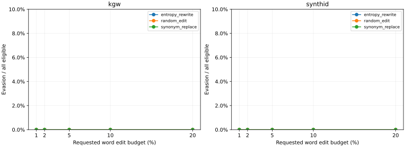
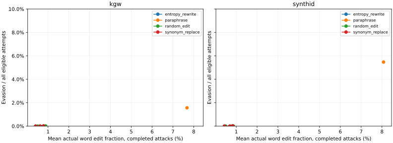
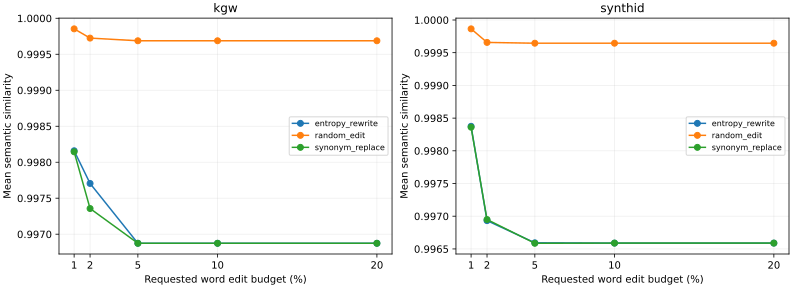

# Experiment 003 — Baseline Attack Results

Measured local results for NullMark v0.2.0. All reported outputs use attack version **2**. This is a controlled robustness study, not a universal watermark-removal claim.

## Configuration and eligibility

- Model: existing `qwen3.5:9b-q4_K_M`, GGUF SHA-256 `02d45dc1cf451ba2475ac33b301c2dd8f985abe4c182ce04a1f2f5bf0260278d`.
- Generation: temperature .8, top-k 40, top-p .95, maximum 192 new tokens; one existing frozen key configuration per scheme. SynthID: depth 20, weighted mean.
- Fresh corpus: 240 original prompts, eight styles; first 128 (16/style) used per scheme. Public benchmark seed 20261021. Calibration and attack IDs and normalized texts are disjoint.
- Frozen v0.1.1 evaluators unchanged: target FPR **1%**, distinct from SynthID depth-20 weighted **3/99 (3.03%) observed held-out FPR**. No attack-data calibration.
- 256 originals and 4,096 configured attack attempts. The paired prompt/seed setup and single key configuration do not establish population or cross-key robustness.

|Scheme|Eligible / generated|Eligibility|Baseline miss|Baseline abstention|
|---|---:|---:|---:|---:|
|kgw|128/128|100.0%|0.0%|0.0%|
|synthid|128/128|100.0%|0.0%|0.0%|

## What this run shows

Paraphrase caused the largest measured detector disruption: **2/128 KGW evasions
(1.56%)** and **7/128 SynthID evasions (5.47%)**. Its **29/128 KGW (22.66%)** and
**32/128 SynthID (25.00%)** length-support abstentions are separate outcomes, not
evasion. Mean paired score reductions were **0.9192 KGW z-score** and **0.0168
SynthID weighted mean**, in different units.

Mean paraphrase word edits were **7.68% / 8.08%** for KGW/SynthID, with mean
semantic similarities **0.9925 / 0.9909**. These averages include many near-copies.
The two KGW evasion examples changed **13.66% and 52.85%** of words; the seven
SynthID evasion examples changed **22.46%–50.00%**. Those are observed operating
points, not a minimum-edit estimate or a guarantee of factual preservation.

Every sparse operating point had **0/128 evasion per scheme**. Mean actual word
changes remained below 1% because safe candidates exhausted early. The 5/10/20%
requested curves often coincide; this does **not** establish robustness at 20%
actual editing. Random Edit retained the highest mean cosine while making very
few changes. Entropy ordering did not produce an evasion advantage over seeded
local selection in this constrained proposal pool; it was not consistently better
than the different Random Edit lexicon either. Proposal availability limits that
comparison, and the results do not establish that entropy guidance is generally
ineffective.

At cosine ≥.90, paraphrase evasion was **2/128 KGW and 7/128 SynthID**. At ≥.95,
it was **2/127 (1.57%)** and **6/126 (4.76%)**; coverage was 127/128 and 126/128.
The remaining denominator members include detected samples and abstentions.
Under this one configuration, SynthID had more measured paraphrase evasion than
KGW. Different units, calibration length support and candidate exhaustion prevent
turning that observation into a universal scheme ranking.

## Detector outcomes by budget

All rates below use every eligible attempt, including failures and abstentions. Evasion means original DETECTED → attacked NOT DETECTED. Abstention is not evasion. Score reductions are paired means among completed scored outputs; distribution counts in JSON expose missing scores. KGW and SynthID score units differ.

### kgw

|Attack|Requested budget|N|Complete|Evasion|Detected|Abstain|Failure|Before|After|Reduction|
|---|---:|---:|---:|---:|---:|---:|---:|---:|---:|---:|
|random_edit|1%|128|100.0%|0.0%|100.0%|0.0%|0.0%|7.117|7.023|0.093|
|random_edit|2%|128|100.0%|0.0%|100.0%|0.0%|0.0%|7.117|6.981|0.136|
|random_edit|5%|128|100.0%|0.0%|100.0%|0.0%|0.0%|7.117|6.969|0.148|
|random_edit|10%|128|100.0%|0.0%|100.0%|0.0%|0.0%|7.117|6.969|0.148|
|random_edit|20%|128|100.0%|0.0%|100.0%|0.0%|0.0%|7.117|6.969|0.148|
|synonym_replace|1%|128|100.0%|0.0%|98.4%|1.6%|0.0%|7.117|7.069|0.047|
|synonym_replace|2%|128|100.0%|0.0%|98.4%|1.6%|0.0%|7.117|7.036|0.080|
|synonym_replace|5%|128|100.0%|0.0%|97.7%|2.3%|0.0%|7.117|7.016|0.101|
|synonym_replace|10%|128|100.0%|0.0%|97.7%|2.3%|0.0%|7.117|7.016|0.101|
|synonym_replace|20%|128|100.0%|0.0%|97.7%|2.3%|0.0%|7.117|7.016|0.101|
|paraphrase|actual edits|128|100.0%|1.6%|75.8%|22.7%|0.0%|7.117|6.197|0.919|
|entropy_rewrite|1%|128|100.0%|0.0%|98.4%|1.6%|0.0%|7.117|7.052|0.064|
|entropy_rewrite|2%|128|100.0%|0.0%|98.4%|1.6%|0.0%|7.117|7.040|0.077|
|entropy_rewrite|5%|128|100.0%|0.0%|97.7%|2.3%|0.0%|7.117|7.016|0.101|
|entropy_rewrite|10%|128|100.0%|0.0%|97.7%|2.3%|0.0%|7.117|7.016|0.101|
|entropy_rewrite|20%|128|100.0%|0.0%|97.7%|2.3%|0.0%|7.117|7.016|0.101|

### synthid

|Attack|Requested budget|N|Complete|Evasion|Detected|Abstain|Failure|Before|After|Reduction|
|---|---:|---:|---:|---:|---:|---:|---:|---:|---:|---:|
|random_edit|1%|128|100.0%|0.0%|100.0%|0.0%|0.0%|0.575|0.573|0.002|
|random_edit|2%|128|100.0%|0.0%|100.0%|0.0%|0.0%|0.575|0.572|0.003|
|random_edit|5%|128|100.0%|0.0%|100.0%|0.0%|0.0%|0.575|0.572|0.003|
|random_edit|10%|128|100.0%|0.0%|100.0%|0.0%|0.0%|0.575|0.572|0.003|
|random_edit|20%|128|100.0%|0.0%|100.0%|0.0%|0.0%|0.575|0.572|0.003|
|synonym_replace|1%|128|100.0%|0.0%|100.0%|0.0%|0.0%|0.575|0.573|0.001|
|synonym_replace|2%|128|100.0%|0.0%|98.4%|1.6%|0.0%|0.575|0.572|0.003|
|synonym_replace|5%|128|100.0%|0.0%|98.4%|1.6%|0.0%|0.575|0.572|0.003|
|synonym_replace|10%|128|100.0%|0.0%|98.4%|1.6%|0.0%|0.575|0.572|0.003|
|synonym_replace|20%|128|100.0%|0.0%|98.4%|1.6%|0.0%|0.575|0.572|0.003|
|paraphrase|actual edits|128|100.0%|5.5%|69.5%|25.0%|0.0%|0.575|0.558|0.017|
|entropy_rewrite|1%|128|100.0%|0.0%|99.2%|0.8%|0.0%|0.575|0.573|0.002|
|entropy_rewrite|2%|128|100.0%|0.0%|98.4%|1.6%|0.0%|0.575|0.572|0.002|
|entropy_rewrite|5%|128|100.0%|0.0%|98.4%|1.6%|0.0%|0.575|0.572|0.003|
|entropy_rewrite|10%|128|100.0%|0.0%|98.4%|1.6%|0.0%|0.575|0.572|0.003|
|entropy_rewrite|20%|128|100.0%|0.0%|98.4%|1.6%|0.0%|0.575|0.572|0.003|

## Text preservation by budget

Metrics are continuous; no universal quality cutoff is used. Semantic cosine is **not factual correctness**. Anchor counts are literal numbers/numeric dates, percentages, URLs and emails; they do not certify all facts or names. A completed no-op has zero edits and can inflate mean semantic similarity.

|Scheme|Attack|Budget|Semantic|Word edits|Token edits|Length ratio|Lexical|Anchors retained / total|Added|No-op|Mean seconds|
|---|---|---:|---:|---:|---:|---:|---:|---:|---:|---:|---:|
|kgw|random_edit|1%|1.000|0.5%|0.4%|1.000|0.988|23/23|0|23.4%|0.011|
|kgw|random_edit|2%|1.000|0.8%|0.7%|1.000|0.982|23/23|0|23.4%|0.011|
|kgw|random_edit|5%|1.000|0.9%|0.7%|1.000|0.980|23/23|0|23.4%|0.010|
|kgw|random_edit|10%|1.000|0.9%|0.7%|1.000|0.980|23/23|0|23.4%|0.011|
|kgw|random_edit|20%|1.000|0.9%|0.7%|1.000|0.980|23/23|0|23.4%|0.010|
|synthid|random_edit|1%|1.000|0.5%|0.4%|1.000|0.988|21/21|0|25.8%|0.011|
|synthid|random_edit|2%|1.000|0.8%|0.7%|1.000|0.981|21/21|0|25.8%|0.011|
|synthid|random_edit|5%|1.000|0.9%|0.7%|1.000|0.980|21/21|0|25.8%|0.010|
|synthid|random_edit|10%|1.000|0.9%|0.7%|1.000|0.980|21/21|0|25.8%|0.011|
|synthid|random_edit|20%|1.000|0.9%|0.7%|1.000|0.980|21/21|0|25.8%|0.011|
|kgw|synonym_replace|1%|0.998|0.4%|0.4%|1.000|0.991|23/23|0|38.3%|2.631|
|kgw|synonym_replace|2%|0.997|0.6%|0.6%|1.000|0.986|23/23|0|38.3%|0.012|
|kgw|synonym_replace|5%|0.997|0.8%|0.8%|1.000|0.982|23/23|0|38.3%|0.012|
|kgw|synonym_replace|10%|0.997|0.8%|0.8%|1.000|0.982|23/23|0|38.3%|0.012|
|kgw|synonym_replace|20%|0.997|0.8%|0.8%|1.000|0.982|23/23|0|38.3%|0.012|
|synthid|synonym_replace|1%|0.998|0.4%|0.4%|1.000|0.989|21/21|0|34.4%|2.552|
|synthid|synonym_replace|2%|0.997|0.7%|0.7%|1.000|0.983|21/21|0|34.4%|0.013|
|synthid|synonym_replace|5%|0.997|0.8%|0.8%|1.000|0.981|21/21|0|34.4%|0.012|
|synthid|synonym_replace|10%|0.997|0.8%|0.8%|1.000|0.980|21/21|0|34.4%|0.012|
|synthid|synonym_replace|20%|0.997|0.8%|0.8%|1.000|0.980|21/21|0|34.4%|0.012|
|kgw|paraphrase|actual edits|0.992|7.7%|7.3%|1.011|0.891|23/23|0|13.3%|2.559|
|synthid|paraphrase|actual edits|0.991|8.1%|7.7%|1.011|0.885|21/21|0|13.3%|2.599|
|kgw|entropy_rewrite|1%|0.998|0.4%|0.4%|1.000|0.991|23/23|0|38.3%|0.092|
|kgw|entropy_rewrite|2%|0.998|0.6%|0.6%|1.000|0.986|23/23|0|38.3%|0.012|
|kgw|entropy_rewrite|5%|0.997|0.8%|0.8%|1.000|0.982|23/23|0|38.3%|0.012|
|kgw|entropy_rewrite|10%|0.997|0.8%|0.8%|1.000|0.982|23/23|0|38.3%|0.012|
|kgw|entropy_rewrite|20%|0.997|0.8%|0.8%|1.000|0.982|23/23|0|38.3%|0.012|
|synthid|entropy_rewrite|1%|0.998|0.4%|0.4%|1.000|0.989|21/21|0|34.4%|0.093|
|synthid|entropy_rewrite|2%|0.997|0.7%|0.7%|1.000|0.983|21/21|0|34.4%|0.012|
|synthid|entropy_rewrite|5%|0.997|0.8%|0.8%|1.000|0.981|21/21|0|34.4%|0.012|
|synthid|entropy_rewrite|10%|0.997|0.8%|0.8%|1.000|0.980|21/21|0|34.4%|0.012|
|synthid|entropy_rewrite|20%|0.997|0.8%|0.8%|1.000|0.980|21/21|0|34.4%|0.012|

Timings are amortized sweep wall times: first uncached budgets pay for shared linguistic analysis; later budgets and Entropy Rewrite reuse it. Native loading may be charged to the first request. These are not independent cold-start costs.

## Quality-conditioned evasion

The .90/.95 cosine bands are descriptive operating points, not universal semantic or factual guarantees. The [full generated summary](benchmarks/qwen-v020/summary.md) lists every numerator, denominator and eligible-sample coverage. Complete 5/25/50/75/95 percentiles are in [metrics.json](benchmarks/qwen-v020/metrics.json).

## Static figures

[Score reductions](benchmarks/qwen-v020/plots/score_reduction.svg) · [Semantic similarity versus post-attack score](benchmarks/qwen-v020/plots/semantic-vs-score.svg) · [Quality-conditioned evasion](benchmarks/qwen-v020/plots/quality-conditioned.svg) · [Per-sample Pareto CSV](benchmarks/qwen-v020/pareto.csv)

## Qualitative inspection and limitations

[Deterministic comparison inspection](baseline-attack-inspection.md) covers eight styles × four families × two schemes, at 5% requested budget for sparse attacks and the one-pass paraphrase. No-ops, emphasis drift, awkward idioms, source truncation and source factual errors are visible. It is qualitative inspection by the coding agent, not independently annotated human ground truth.

The conservative random lexicon and extracted local alternatives can exhaust candidates well below requested budgets. Local and entropy methods share a proposal pool; Random Edit uses a different lexicon, so entropy-versus-random differences are not a pure position-selection ablation. The matched local-versus-entropy comparison helps interpret that limitation. Source generations may be incomplete at the frozen 192-token limit and may contain incorrect claims. Preserving those claims does not make them true. Full paraphrases may drift despite high cosine. Length-support abstentions remain separate from evasion.

Attack version 2 was frozen after linguistic QA, before any post-attack detector evaluation. Preliminary version-1 outputs are excluded. All reported attempts use version 2. Keys, detector scores, thresholds, calibration artifacts and native generation IDs were never passed to the attack worker.

Public exports include all attempts and evaluator results, with private masters, native private artifacts, weights and inference caches excluded. The [manifest](benchmarks/qwen-v020/manifest.json) retains stage/source provenance; baseline generation began from a dirty working tree based on the unchanged v0.1.1 generation/detector implementation. Attack-stage source commits are recorded separately. Frozen hashes match the pre-heldout snapshot.

**v0.3 Sparse Keyless Disruption has NOT been started.**
