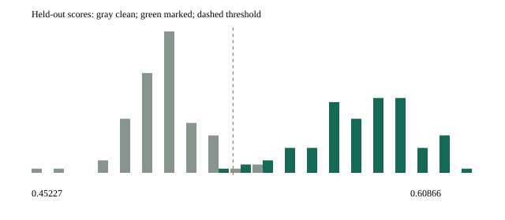

# Qwen detector calibration: measured v0.1.1 results

The completed study shows clear watermark score separation. **None of the six SynthID operating points achieved an observed held-out FPR at or below 1%.** Their thresholds were calibrated with a 1% target, then frozen; they were not adjusted after seeing evaluation results. This is a useful exploratory operating-point study, not proof of a 1% population false-positive rate.

Recommend **SynthID depth 20, weighted mean**, with the existing frozen threshold **0.5236017624956073** for a future exploratory Qwen benchmark. It detected 97/98 eligible marked outputs with 3/99 clean false positives. Its observed TPR is similar to the other weighted modes, its FPR is lower than depth 10/30 weighted in this sample, and it runs substantially faster than depth 30. Differences of a few examples are not evidence of statistical superiority. If a benchmark requires demonstrated population FPR ≤1%, this study does not establish that requirement.

## Design and provenance

Run date: 2026-10-20. Public split seed: **20261020**. A fixed corpus of 240 original prompts covers factual, technical, essay, argument, narrative, instructions, science and general knowledge. Deterministic style-balanced disjoint splits use **128 calibration + 100 evaluation prompts**, leaving 12 unused. Each prompt generates plain, KGW and SynthID depth 10/20/30 continuations: **1,140 generations and 3,192 detector observations**. Raw and weighted modes score the same continuation at each depth; clean controls are shared, so comparisons are paired rather than independent.

Only clean calibration scores with at least 64 usable tokens fit thresholds: **122 SynthID / 124 KGW**. Six SynthID clean outputs and four KGW clean outputs were excluded from their respective calibration fits. Marked calibration outputs are descriptive only. All seven thresholds were frozen before any held-out generation; the [freeze snapshot](calibration/qwen-v011/freeze-snapshot.json) records zero held-out rows and artifact SHA256 values verified unchanged after completion.

Threshold rule: strict score > ascending rank ceil((n+1)×(1−target FPR)), without interpolation. At these sample sizes the 1% threshold is the maximum eligible clean score; observed calibration FPR is 0/122 or 0/124. Fewer than five expected tail observations triggers a high-uncertainty warning. Zero calibration exceedances does not validate population FPR.

Model: existing Ollama-installed `qwen3.5:9b-q4_K_M`, directly loaded through llama-cpp-python 0.3.36, RTX 4070 SUPER 12 GB full GPU offload; watermark processing on CPU. GGUF SHA256 `02d45dc1cf451ba2475ac33b301c2dd8f985abe4c182ce04a1f2f5bf0260278d`. Temperature 0.8, top-k 40, top-p 0.95, 192 maximum new tokens, context 2048, eight threads, non-thinking template request. Total study runtime **6,875.73 seconds (114.60 minutes)** excluding model loading, including generation, scoring and reporting.

[Resolved config](calibration/qwen-v011/config.resolved.yaml), [split IDs and prompts](calibration/qwen-v011/splits.json), [original environment/model manifest](calibration/qwen-v011/manifest.json), [source annotation](calibration/qwen-v011/provenance-note.json), and [all aggregate metrics](calibration/qwen-v011/metrics.json) are public. The original launch manifest honestly records a dirty tree based on d1b4716; generation/scoring work was later committed as 6adae6e. Final reporting at 3320de4 reloads existing artifacts without fitting. Exact native IDs, private master, raw scores, per-sample decisions and generated texts remain in ignored `results/002-qwen-128`; they are trusted local evaluator data.

## Frozen operating points

All rows target **1% FPR**. Evaluation class balance is 100 clean + 100 marked per row. TPR/FPR/specificity condition on supported length and successful scoring; abstention and marked yield retain the full denominator. Precision is intentionally null because deployment prevalence is unspecified.

| Detector | Frozen threshold | Calibration n | Held-out TPR | Held-out FPR | Specificity | Abstention | Marked yield |
|---|---:|---:|---:|---:|---:|---:|---:|
| KGW z-score | 1.960392117639214 | 124 | 98.99% (98/99) | 1.01% (1/99) | 98.99% (98/99) | 1.00% (2/200) | 98.00% (98/100) |
| SynthID d10-raw mean-g | 0.5282486081123352 | 122 | 100.00% (97/97) | 6.06% (6/99) | 93.94% (93/99) | 2.00% (4/200) | 97.00% (97/100) |
| SynthID d10-weighted mean | 0.5320049813200498 | 122 | 98.97% (96/97) | 4.04% (4/99) | 95.96% (95/99) | 2.00% (4/200) | 96.00% (96/100) |
| SynthID d20-raw mean-g | 0.5231638550758362 | 122 | 97.96% (96/98) | 5.05% (5/99) | 94.95% (94/99) | 1.50% (3/200) | 96.00% (96/100) |
| SynthID d20-weighted mean | 0.5236017624956073 | 122 | 98.98% (97/98) | 3.03% (3/99) | 96.97% (96/99) | 1.50% (3/200) | 97.00% (97/100) |
| SynthID d30-raw mean-g | 0.5216311812400818 | 122 | 97.92% (94/96) | 2.02% (2/99) | 97.98% (97/99) | 2.50% (5/200) | 94.00% (94/100) |
| SynthID d30-weighted mean | 0.5181254103439028 | 122 | 98.96% (95/96) | 5.05% (5/99) | 94.95% (94/99) | 2.50% (5/200) | 95.00% (95/100) |

For the recommended mode, Wilson 95% intervals are **94.44–99.82% TPR** and **1.04–8.53% FPR**. These binomial approximations show the limited tail precision and do not account for selecting a mode after comparing six candidates. The pooled operating point is not a conditional FPR guarantee for every prompt style or length.

## Score distributions

Visible continuation scores, all 100 scorable held-out examples per class, including examples later abstained for length. Entries are mean [5th, 95th percentile]; complete median/min/max and calibration distributions are in metrics.json.

| Detector | Clean score | Marked score |
|---|---:|---:|
| KGW z-score | -0.140211 [-1.462146, 1.378595] | 5.670336 [2.598076, 8.062691] |
| SynthID d10-raw mean-g | 0.500432 [0.477465, 0.528723] | 0.573830 [0.539785, 0.604082] |
| SynthID d10-weighted mean | 0.501348 [0.480083, 0.528092] | 0.579491 [0.538528, 0.613915] |
| SynthID d20-raw mean-g | 0.500986 [0.485135, 0.518452] | 0.559666 [0.527320, 0.584459] |
| SynthID d20-weighted mean | 0.500824 [0.483265, 0.519902] | 0.569022 [0.536906, 0.595475] |
| SynthID d30-raw mean-g | 0.500998 [0.483883, 0.517117] | 0.547346 [0.526241, 0.569281] |
| SynthID d30-weighted mean | 0.500875 [0.486930, 0.518022] | 0.557766 [0.533540, 0.582131] |

The historical SynthID 0.60 threshold is a demo constant, not a calibrated universal rule. Depth increases do not monotonically improve this measured operating point. Weighted mean uses the [pinned Google DeepMind reference weights](https://github.com/google-deepmind/synthid-text/blob/a6ec02c22ce87177c061643503e14a7cc839dc2b/src/synthid_text/detector_mean.py): descending linear layer weights from 10 to 1, normalized. Raw mean-g remains available unchanged.



The histogram and saved ROC-style threshold sweeps are descriptive only; neither refits the frozen operating point.

## Usable length

The frozen SynthID support is **64–188 usable tokens**; KGW is **64–191**. Counts outside support abstain, rather than becoming negatives. All five requested buckets, both visible and usable token counts, score distributions and intervals are stored for all seven modes in metrics.json. The recommended mode is shown below. The 128–255 bucket contains only lengths ≤188 here.

| Usable tokens | Clean / marked count | TPR | FPR | Abstention | Clean / marked mean score |
|---|---:|---:|---:|---:|---:|
| <64 | 1 / 2 | — (0 eligible) | — (0 eligible) | 100.00% (3/3) | 0.503366 / 0.582262 |
| 64–127 | 37 / 37 | 97.30% (36/37) | 5.41% (2/37) | 0.00% (0/74) | 0.500671 / 0.567702 |
| 128–255 | 62 / 61 | 100.00% (61/61) | 1.61% (1/62) | 0.00% (0/123) | 0.500875 / 0.569389 |
| 256–511 | 0 / 0 | — (0 eligible) | — (0 eligible) | — (0 eligible) | — / — |
| 512+ | 0 / 0 | — (0 eligible) | — (0 eligible) | — (0 eligible) | — / — |

No 256+ output was generated under the 192-token cap, so those buckets support no conclusion. Shorter eligible outputs have more variable scores; no separate bucket thresholds were introduced.

## Native versus visible text

Diagnostics below pool calibration and evaluation (228 outputs per class per row). All clean native-minus-visible score deltas are zero. All rows have median delta 0 and 95th-percentile absolute delta 0. **Rare nonzero SynthID deltas exist and are not hidden by the zero 95th percentile.**

| Detector | Marked mean delta | Marked maximum absolute delta | Exact roundtrip, clean / marked | Frozen-threshold disagreements |
|---|---:|---:|---:|---:|
| KGW z-score | 0.000000000 | 0.000000000 | 40.79% / 39.91% | 0 |
| SynthID d10-raw mean-g | 0.000024433 | 0.005570829 | 40.79% / 39.91% | 0 |
| SynthID d10-weighted mean | 0.000025993 | 0.005926457 | 40.79% / 39.91% | 0 |
| SynthID d20-raw mean-g | 0.000014715 | 0.003355026 | 40.79% / 40.79% | 0 |
| SynthID d20-weighted mean | 0.000018487 | 0.004214979 | 40.79% / 40.79% | 0 |
| SynthID d30-raw mean-g | 0.000019999 | 0.004559696 | 40.79% / 39.91% | 0 |
| SynthID d30-weighted mean | 0.000024885 | 0.005673860 | 40.79% / 39.91% | 0 |

Nonexact ID roundtrips are common because native generation retains end-of-generation controls omitted from displayed text. Most do not change detector scores. Rare SynthID score losses are small in this run, with no frozen-threshold disagreements; this is not a universal tokenizer guarantee. Visible text remains the evaluation authority.

Nonzero deltas occurred in three unique generations: one calibration output each
at depths 20 and 30, and one held-out output at depth 10. Each affects both score
modes for that generation. All other score rows have zero delta.

## Generation cost and qualitative inspection

Timing pools all 228 generations per path. Throughput is the mean of per-generation native sampled-token rates; latency includes prompt processing and is not normalized for length. Callback time includes watermark processing, validation and array copies, excluding processor construction, model loading and detector work. It is not the complete end-to-end slowdown.

| Generation path | Mean tokens/s | Mean latency s | Mean callback s | Mean native / visible / usable tokens |
|---|---:|---:|---:|---:|
| Plain | 68.33 | 2.109 | 0.000 | 145.26 / 144.67 / 140.57 |
| KGW z-score | 60.67 | 2.412 | 0.370 | 146.14 / 145.54 / 144.54 |
| SynthID d10-raw mean-g | 32.18 | 4.535 | 2.463 | 145.11 / 144.50 / 140.39 |
| SynthID d20-raw mean-g | 18.81 | 7.852 | 5.334 | 145.21 / 144.62 / 140.56 |
| SynthID d30-raw mean-g | 12.30 | 11.996 | 8.272 | 146.04 / 145.44 / 141.34 |

Raw and weighted detectors share generation costs at each depth. Depth 20 produces about **18.81 tokens/s**, versus 32.18 at depth 10 and 12.30 at depth 30 (plain 68.33). Depth 20 is roughly 42% slower in token throughput than depth 10 and 53% faster than depth 30. This CPU watermark hook is a substantial practical cost, not negligible overhead.

Manual inspection covered 40 calibration continuations: the first deterministic prompt in each of eight styles, across all five generation paths. All depths produced readable, topical prose; longer responses often truncated at the 192-token cap, including plain controls, and some factual claims were questionable. This was not blinded preference testing and cannot establish quality noninferiority. No semantic-quality model was added; exact inspected prompt IDs are in [local-model-verification.md](local-model-verification.md).

## KGW comparison

Empirical threshold **z > 1.9603921176392136** produced 98/99 TPR and 1/99 FPR, with two length abstentions. Legacy **z > 3** yielded 93/100 TPR and 0/100 FPR on all scorable held-out outputs; its denominator includes short outputs excluded by the calibrated length policy. The nominal one-sided normal tail at z=3 is about 0.135%, a different target from 1%, and the real repeated-ngram/tokenizer behavior need not follow that approximation. These data do not establish equivalence to the theoretical tail or justify changing the historical demo threshold.

## Reusing the recommendation

The [frozen artifact](calibration/qwen-v011/synthid-d20-weighted_mean-fpr-0.01.calibration.json) has calibration ID `00398a7a59f5d82071135da27bcc6bb9b3d27ae44f9f222fbe0d296909706530`. It requires this model digest/backend, sampling settings, public watermark configuration and matching private master/key reference. A public artifact alone cannot recreate private watermark keys. The current local matching master remains in the ignored run directory.

```sh
nullmark playground --calibration docs/calibration/qwen-v011/synthid-d20-weighted_mean-fpr-0.01.calibration.json --secrets results/002-qwen-128/private/secrets.json
```

Choose local Qwen GPU, context 2048, max 192, temperature 0.8/top-k 40/top-p 0.95, SynthID depth 20, weighted mean, hidden key index 0 and the loaded artifact. With no compatible artifact the UI displays an uncalibrated score; unsupported samples show INSUFFICIENT EVIDENCE. Frozen-evaluator and originally-detected-baseline guards are available for future benchmark code. A baseline miss or abstention cannot be counted as successful evasion.

The calibrated browser verification replays one saved held-out narrative prompt/seed to check presentation. It is a UI check, not additional independent evaluation evidence.


## Limits and stop condition

One model/quantization, one private master, one curated prompt corpus, one hardware/runtime configuration, and a short output cap limit generalization. The clean tail is sparse, observed FPR exceeds target for all SynthID modes, and comparing modes on this held-out set makes the chosen recommendation exploratory. A fresh independent confirmation and a larger clean tail are required before a strict 1% population-FPR claim. Thresholds are preserved, not retuned to make the table look better. Longer text, cross-key robustness, semantic-quality models, blinded human quality testing, Bayesian detectors and attacks were not evaluated.

The scientific questions have been answered at the stated exploratory scale; no further tuning is performed. Experiment 001 remains byte-for-byte unchanged. **v0.2 attack implementation has NOT started.**
