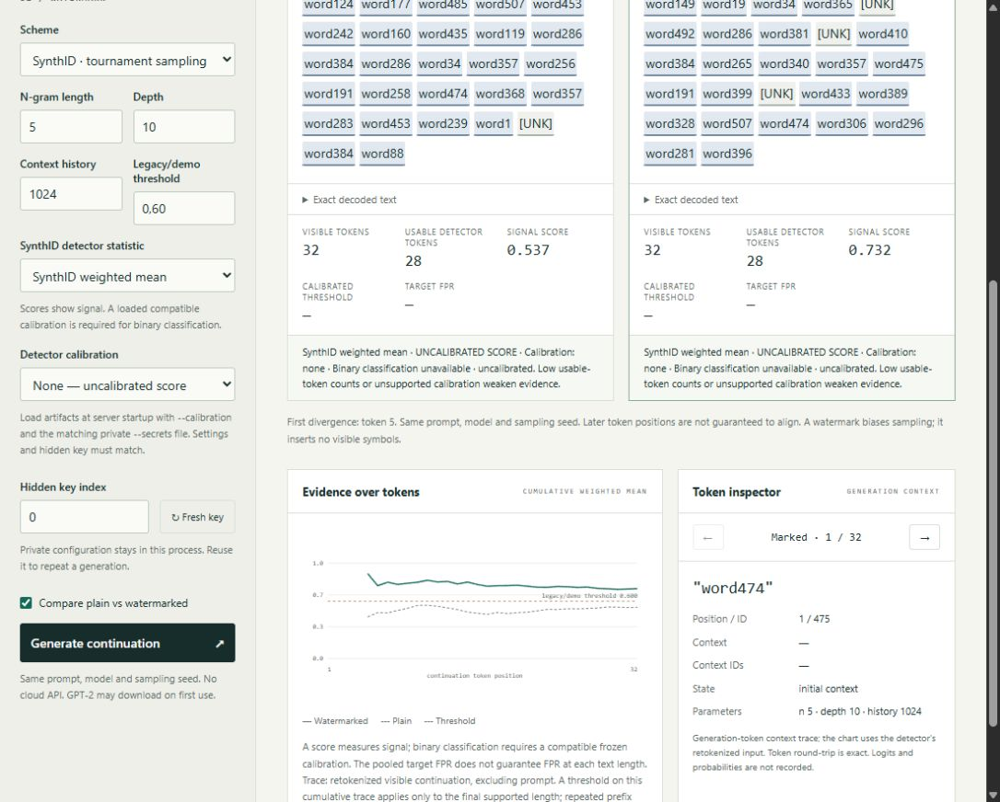
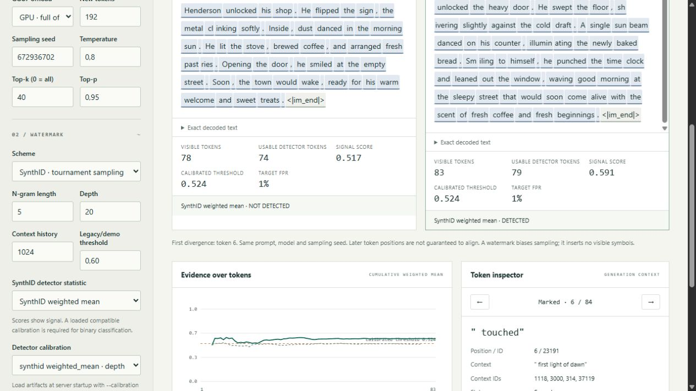

# Visual Playground

## Sparse Keyless Disruption — v0.3

Choose **SKD** under Detector-blind attacks, then request **1, 2, 3 or 5 edits**.
The installed Qwen model proposes localized alternatives; the pinned cached
MiniLM model provides attack-side semantic checks. No detector result or key is
available to the attack worker.

The candidate inspector highlights source spans. Click a span or choose an
alternative in the candidate selector to see raw feature values, per-sample
normalized ranks, the final score, local embedding cosine and selection state.
Selected edits are numbered in source order. Coverage distinguishes proposals,
unique safe candidates and maximum selectable non-overlapping spans. Exhaustion
reports requested and actual edits explicitly.

**Research selection** exposes random, entropy, context and tokenizer ranking
over the same candidate generation protocol. Keep the generation and attack seed
fixed when comparing. The reproducible Experiment 004 is the authoritative
matched-pool comparison, with saved pool hashes and all five selectors in one
worker session.

The displayed attack time includes the shared candidate-generation/feature cost.
In benchmark records, that same shared cost is attributed to each selector and
budget; summing those row runtimes overcounts total compute. The final text's
semantic similarity and word/token edit fractions are separate measurements.
Evaluator results are labeled **not available to SKD** and appear only after the
transformed text is finalized. Ineligible baselines and abstentions retain their
existing meanings. See [the fixed research protocol](skd.md).

The playground is a local research instrument for existing generation and
detection behavior. The CLI remains the authoritative reproducible experiment
workflow; this interface is interactive exploration and demonstration.

## Install and launch

```sh
pip install -e ".[gui]"
nullmark playground
```

Open http://127.0.0.1:8765. Change the port with
`nullmark playground --host 127.0.0.1 --port 8766`. Stop with Ctrl+C.
Only loopback host choices are supported. Core CLI commands and tests do not
require GUI dependencies. GUI tests use `pip install -e ".[dev,gui,gui-test]"`.

FastAPI/Uvicorn serve bundled HTML, CSS and JavaScript without a frontend build
step. Generation runs in a worker thread; a nonblocking lock admits one generation
or key change at a time. The active model/device is cached; switching evicts it.
CPU is tested; selecting unavailable CUDA returns a controlled error.

## Models and workflow

- **builtin-tiny:** offline, fast, fixed random weights and a synthetic vocabulary.
  Demonstrates software behavior, not natural language quality.
- **GPT-2:** `openai-community/gpt2`, pinned to
  `607a30d783dfa663caf39e06633721c8d4cfcd7e`, as in Experiment 001.
  Natural-language continuations; first use may download weights/tokenizer.
  Slower on CPU. Prompt plus output must fit its 1024-token context.
- **Ollama / local GGUF:** supported modern instruction models already installed
  locally. Ollama discovers the model; llama-cpp-python performs direct inference
  on the same weights with dynamic watermark processing before sampling. The
  Windows validation used Qwen 3.5 9B Q4_K_M. This is not universal Ollama support.

Interactive sampling defaults are temperature **0.8**, top-k **40**, top-p **0.95**.
Controls and results show the resolved values. They are not silently inherited
from Ollama's Modelfile. Core ModelConfig defaults remain **1.0 / 0 / 1.0**;
Experiment 001 explicitly pins these historical settings. Sampling is present in
resolved configurations, manifests, evaluator provenance and playground metadata.

Choose None, KGW or SynthID, set public parameters/seed, enter a prompt and generate.
Output is limited to 16–512 tokens; prompts to 16,000 characters, with model
context limits checked separately. Loading/generation displays a progress state.
Errors appear inline; terminal logs retain the error class, suppressing upstream
message contents that may contain private settings.

Paired plain and marked paths share model, prompt and public seed. Panels show
counts, relevant detector score/threshold/prediction and first divergence. Later
positions need not align: a changed sample changes future context. Watermarks
bias sampling; they insert no visible symbols. None generates one plain sample
without a detector.

## Calibrated detector presentation

Select **SynthID raw mean-g** or **SynthID weighted mean** explicitly. Results show
visible tokens, usable detector tokens, signal score, calibrated threshold and
target FPR. Without calibration the interface says **UNCALIBRATED SCORE** and
**Binary classification unavailable**. Legacy/demo lines on the trace are educational
references. A partial prefix crossing is not a calibrated sequential test.

Load a frozen artifact and its matching private master at server startup:

```sh
nullmark playground --calibration docs/calibration/qwen-v011/synthid-d20-weighted_mean-fpr-0.01.calibration.json --secrets results/002-qwen-128/private/secrets.json
```

Repeat `--calibration` to offer multiple artifacts in the selector. Set the same
model, sampling settings, maximum output length, depth and key index as the run.
Fresh key makes the previous calibration incompatible. The server reads private
files locally; the browser receives neither keys nor filesystem paths. An incompatible
artifact disables classification. Unsupported usable lengths or insufficient clean
calibration counts produce **INSUFFICIENT EVIDENCE**. The threshold applies only
within its frozen length regime, and pooled FPR does not imply FPR in every bucket.

See [the protocol](detector-calibration.md) and the verified score-only view:



The measured Qwen recommendation uses depth 20 and weighted mean with threshold
0.5236017624956073. The public artifact requires the original matching private
master; a fresh run creates its own master and artifacts. Its target FPR is 1%,
but observed held-out FPR was 3/99: see [measured limits and configuration](detector-calibration-results.md).
The calibrated UI replay showed plain score 0.517 (NOT DETECTED) and marked score
0.591 (DETECTED), with 74/79 usable tokens. No browser warnings/errors appeared.



## Hidden key lifetime

The process creates an OS-random master in memory. Key index selects a stable slot
under that master. Repeating settings/seed reuses it; **Fresh key** rotates the
master for future requests. Existing results retain their original context.
Restart discards the master: use CLI private replay files for durable replay.
There is no reveal control, key upload or key-file HTTP route.

Only HMAC-SHA256(master, `nullmark-v1/key-ref/<scheme>/<index>`) is returned. A direct
hash permits testing guessed small-keyspace secrets offline; the new reference
cannot be recomputed from derived-key guesses alone. It identifies the key slot,
not all public parameters. This assumes a private random master, not stronger
upstream watermark security. Old v0.1.0 fingerprints remain vulnerable; replace
them and rotate affected masters where secrecy matters. Key derivation is unchanged.

## KGW: membership and evidence

Green uses a solid underline; red a dotted underline, with G/R text in accessible
names/tooltips and the inspector. Special/unavailable tokens appear neutral.
Membership uses the pinned HF processor and actual generation context including
the prompt. The inspector shows position, text, ID, context text/IDs, membership
and a context-stream cumulative z. Public controls affect the next generation.

The chart instead follows **retokenized continuation text only**, matching the
experiment detector, excluding prompt and initial context. Its final score matches
the detector. These streams may differ after decoding and retokenization; the
inspector reports round-trip equality. The generation-context cumulative score
is not the final experiment score.

Pinned HF 4.57.6's `ignore_repeated_ngrams=True` counter uses tensor identities:
repeated n-grams actually count separately. The playground preserves v0.1
detection and traces its actual behavior. Repeated text is not independent
evidence. Regression tests cover it; any future detector correction needs
separate scientific evaluation/versioning.

Detection reports a z-score, usable counts and, with a compatible artifact, a
frozen threshold and three-state result. The standard normal-approximation
upper-tail p-value is a legacy diagnostic, not empirical calibration or a
probability of AI generation.

## SynthID: depth values and masks

SynthID has no red/green partition. Select tokens for depth g-values, token mean-g
and cumulative mean-g. The processor's first n−1 generation calls are unwatermarked;
subsequent state uses preceding continuation tokens, not prompt context. Repeated
contexts and EOS suffixes use the existing reference mean detector's masks.
Neutral positions are initial context or masked.

The chart follows the selected raw or weighted mean statistic for both samples.
Its threshold line is labeled calibrated or legacy/demo. A calibrated line applies
only to the final supported length, not repeated testing of every prefix. Scores
are not posterior probabilities of AI generation. Uncalibrated, entirely masked,
short or unsupported inputs cannot issue a binary decision.

## Stepper, charts and limits

Click/focus token buttons or use Previous/Next for watermark-state inspection.
Charts label axes/threshold; panels and the inspector provide numeric text
equivalents. No animation is required. Desktop is primary; narrow screens stack
panels. Controls have labels, focus states and non-color token distinctions.

Generation logits, ranked distributions and base/marked probabilities are omitted:
v0.1 did not record them. Token states use exact generated IDs. GPT-2 byte-level
tokens may split Unicode characters, causing replacement glyphs in individually
decoded fragments; the exact decoded continuation is available separately.
There is no folder browser, persistence, benchmark runner, job queue, attack logic,
additional watermark family or future experiment dashboard.

## Local security model

This is trusted researcher/evaluator tooling with detector feedback, outside the
blind attack interface. It is not hardened for hostile networks or shared users.
Loopback binding, host/origin checks, bounded JSON, fixed asset paths and a content
security policy reduce accidental exposure. No raw master/derived key is returned,
no private file is served, and no arbitrary code/plugin endpoint exists. Text is
inserted as text nodes, not HTML. No uploads, telemetry or external web assets;
only optional normal Hugging Face model downloads may use the network. Keep
private replay files away from future untrusted workers.

No attacks ship here. Next: **v0.2 — Baseline Attacks**.


## Ollama-installed GGUF

Keep Ollama running on `127.0.0.1:11434`, then select **Ollama / local GGUF** and
refresh. Choose an installed model explicitly; no large model is loaded merely
by opening the selector. The UI shows its name, quantization and installed size.
The Modelfile's local FROM paths and the local manifest identify the language
GGUF separately from vision projectors. Cloud-only models, adapter layers,
ambiguous/multiple language blobs and unreadable/non-GGUF weights are rejected.
The absolute blob path is kept internal, not served or put in public provenance.
Its full SHA-256 is verified at load; results record that hash and Ollama model ID.

Ollama is used to discover installed weights. The normal `/api/chat` API does not
give this application the general per-token watermark hook it needs. NullMark
therefore performs direct inference against the same local GGUF with
llama-cpp-python **0.3.36**, bridging exact IDs and logits into the existing HF
KGW/SynthID processors before native sampling. No finished text is rewritten or
labelled as watermarked after the fact. The bridge verifies callback invocation,
prefix IDs and vocabulary shape and fails closed on callback errors. The pinned
native version matters: rerun the capability check when changing builds/models.

### Optional installation

`.[gui]` still serves builtin-tiny/GPT-2 without llama-cpp-python or Ollama.
GGUF inference is optional:

```sh
pip install -e ".[gui,gguf]"
```

A normal PyPI installation may compile llama.cpp and need CMake plus a compatible
C/C++ toolchain (Visual Studio Build Tools on Windows). Prefer a compatible
[official prebuilt wheel](https://github.com/abetlen/llama-cpp-python#installation).
For CPU, use the official CPU wheel index where your platform/version is offered:

```sh
pip install --only-binary llama-cpp-python --extra-index-url https://abetlen.github.io/llama-cpp-python/whl/cpu llama-cpp-python==0.3.36
pip install -e ".[gui,gguf]"
```

On this verified Windows machine, an RTX 4070 SUPER with a compatible driver used
the official CUDA 13.0 wheel:

```sh
pip install --only-binary llama-cpp-python --extra-index-url https://abetlen.github.io/llama-cpp-python/whl/cu130 llama-cpp-python==0.3.36
pip install -e ".[gui,gguf]"
```

This is a platform-specific option, not a universal CUDA installation command.
A CUDA wheel needs matching native runtimes and driver support even when imported.
On Windows NullMark can reuse the matching installed Ollama cuBLAS DLL directory,
discovered relative to the Ollama executable; no DLLs or model weights are copied.
Otherwise install/configure the wheel's documented runtime or use a CPU build.
A missing/incompatible native runtime produces a controlled diagnostic.

### Check a model

```sh
nullmark model check-ollama "qwen3.5:9b-q4_K_M" --offload auto --tokens 128
```

This local opt-in check verifies blob resolution/hash, load, tokenizer, generation,
same-seed replay, callback on every generated token, an intentionally forced
known token, restoration after removing the callback, and correct-key KGW/SynthID
signal gain over paired controls across three seeds. It also checks a wrong KGW
key. It reports real predictions separately: passing capability/signal checks does
not imply every marked sample crosses a detector threshold. No giant model,
Ollama server or native library is required by ordinary CI tests.

### Chat, state and sampling

The embedded GGUF chat template renders a user message and assistant generation
prefix through the native library's sandboxed Jinja formatter. No Qwen template
is hard-coded. `enable_thinking=False` is supplied; the tested Qwen template
supports it. Other templates may not support this switch, and their thinking
content is left intact rather than deleted. The rendered template digest and
thinking request are recorded. This is text-only inference, not full Ollama
renderer/tool/vision/adapter parity; Modelfile SYSTEM and sampling overrides are
not automatically applied.

The native watermark processor is freshly constructed for every generation and
runs on CPU token IDs/logits; GPU offload applies to model inference. It uses the
real sampled IDs, including EOG, and the actual formatted prompt IDs. The visible
text excludes control tokens; detector-side retokenization stays separate and
round-trip differences are shown. A change in sampling can affect watermark
strength. Native watermarking precedes top-k/top-p/temperature filtering, whereas
Transformers retains its pinned processor order; equal seeds/settings do not
promise identical output across backends or hardware.

Native min-p is disabled and repetition penalty is neutral (1.0); these settings
are recorded. GGUF seed 4294967295 is rejected because llama.cpp reserves it for
random seeding. Choose 0 through 4294967294 for deterministic sampling.

The cache holds one active backend. Switching model/device/offload/context or a
refreshed model digest closes the previous backend before loading another.
Generation callbacks/sampler state are released between runs. Large models take
longer to load, and memory errors remain possible. Auto is conservative: on a
supported NVIDIA build it requests full offload only when reported free memory
exceeds the blob size plus a reserve; otherwise it uses CPU. Explicit GPU requires
an offload-capable build and enough memory. CPU and other accelerator performance
is model/build dependent; this is not a hardware-tuning UI.

GGUF contexts default to 2048 tokens and can be changed under **Inference options**
(up to 8192 in the GUI). Prompt plus continuation is checked before generation.
Model metadata records backend/version, blob digest, quantization, template,
context/offload, threads, sampling and seed provenance, never a local absolute path.
The experiment interface also accepts `backend: ollama-gguf`, an installed model
`name`, and the full **blob** SHA-256 as `revision`; public settings contain no
private path. Actual formatted prompt IDs are stored in private token records.

Expand **Exact decoded text** for uninterrupted prose alongside token fragments.
The CLI remains the authoritative experiment/replay interface. See the
[verification record](release-verification.md) for actual Qwen/GPT-2 results and
limitations, including marked outputs below the original uncalibrated thresholds.


## Baseline attack comparison (v0.2)

After generating a watermarked continuation, choose Random Edit, Local Replacement,
Paraphrase or Entropy Rewrite in **Baseline attacks**. Sparse budgets are upper bounds;
Paraphrase reports measured edits. The latter three use the installed local Qwen
model. Each transformation runs in the independent text-only worker; detector
information visible in this trusted interface is never passed back to that worker.

The three synchronized panels show the original, accessible deletion/insertion diff
(strike/underline plus −/+ signs), and attacked prose. Text preservation reports real
semantic similarity (or explicit Unavailable), word/token edit fractions, length ratio,
lexical similarity and retained anchors. Embeddings do not prove factual correctness.
The separate **Evaluator only** panel displays scores, thresholds and detector states.
An originally missed or abstained sample is explicitly ineligible for evasion claims.
Changing the hidden key requires a new generation before attacking.

Generation resources are released before transformation to avoid holding two GGUF
runtimes on the GPU. The backend is reloaded for trusted post-attack quality/detection.
Model loading can therefore dominate an interactive attack's elapsed time.
See [methodology](baseline-attacks.md) for process-isolation limits and cache setup.
